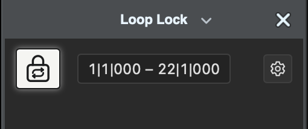

# Loop Lock

A LUNA Browser Add On by **fourdogslong** that preserves the orange Loop ruler range while you move the playback cursor or edit the blue selection.

## Install

Requires LUNA 3.1.2 or later.

- In LUNA, open **Add Ons → Manage → Import URL** and enter `https://github.com/Fourdogslong/loop-lock`.
- Or download `Loop-Lock-0.3.14.lunaaddon` from the [latest release](https://github.com/Fourdogslong/loop-lock/releases/latest) and open it in LUNA.

## Use

1. Open **Loop Lock** from LUNA’s Add Ons Browser.
2. Set an orange range in the Loop ruler and click the padlock button to enable Lock Loop.
3. Click a track lane and press Space to start playback from the edit cursor. LUNA’s transport **Loop** button controls whether playback repeats.
4. Drag the orange range or use LUNA’s **Update Loop** command (⌘L on macOS) to change the loop location.

By default, Loop Lock turns off **Link Edit/Play Selections** while active and restores your previous setting when you turn it off. You can change this in the settings.

Starting at or after the orange loop end plays forward. Loop Lock remembers the range for when you move back before its end. LUNA’s orange ruler may update a moment after the range changes.

## Build

Run `ua-builder pack` from this repository with LUNA Builder SDK 3.1.2. The vendored Universal Audio SDK is available under the Apache 2.0 license in [vendor/LICENSE](vendor/LICENSE) with [vendor/NOTICE](vendor/NOTICE).
